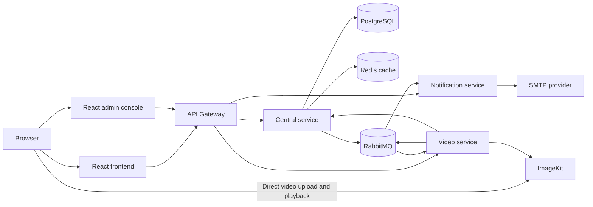

# StreamSphere

StreamSphere is a video-sharing application with React web clients and a Java
17 / Spring Boot microservices backend. This repository contains the public
frontend, an admin console, backend services, and deployment configuration.

## Architecture



### Backend services

| Module | Responsibility | Default local port |
| --- | --- | ---: |
| `api-gateway` | Public API entry point, routing, browser CORS, and runtime API configuration | 8080 |
| `central` | Users, authentication/JWT, channels, video metadata, feeds, admin APIs, and in-app notifications | 8084 |
| `video-service` | ImageKit upload authorization and verification, then metadata persistence through Central | 8083 |
| `notification-api` | RabbitMQ notification consumer and SMTP email delivery | 8082 |
| `service-registry` | Eureka service-registry module | — |

Central uses PostgreSQL as its source of truth and Redis for selected cache
reads. RabbitMQ carries notification messages and asynchronous thumbnail
processing events. New browser video uploads go directly to ImageKit using
short-lived server-issued authorization. Video metadata is initially marked
processing; the Video service generates a thumbnail with FFmpeg (or preserves
an optional creator-uploaded thumbnail) and reports the result to Central.

The Service Registry is present in the Maven project, but the current local
manual startup and Render Blueprint use explicit service URLs; Render does not
deploy the registry module.

### Technology

- **Backend:** Java 17, Spring Boot 3.4.4, Spring Cloud, Maven
- **Web clients:** React 18, Vite, Tailwind CSS, shadcn/ui
- **Data and messaging:** PostgreSQL, Redis, RabbitMQ
- **Media:** ImageKit, FFmpeg/FFprobe for asynchronous thumbnail generation
- **API documentation and health:** OpenAPI/Swagger UI and Spring Actuator

MongoDB and Kafka are not part of the current application configuration.

## Repository layout

```text
admin/                 React admin console
backend/
  api-gateway/         Public API gateway
  central/             Identity, catalog, and metadata service
  notification-api/    Notification consumer and email service
  service-registry/    Eureka registry module
  video-service/       Video upload and media integration
  docs/                Architecture, API, events, and development guides
  docker-compose.yml   Local PostgreSQL, pgAdmin, and Redis
frontend/              React user-facing application
render.yaml            Render backend Blueprint
```

## Run locally

### Prerequisites

- Java 17
- Node.js 20 or a compatible current Node release
- Docker Desktop with Docker Compose
- RabbitMQ for end-to-end notification delivery
- ImageKit credentials for video uploads; SMTP credentials for email delivery
- FFmpeg and FFprobe available on the Video service runtime (included in its
  Docker image)

### 1. Start local dependencies

From PowerShell at the repository root:

```powershell
Set-Location .\backend
Copy-Item .env.example .env
docker compose up -d db redis pgadmin
```

The Compose file starts PostgreSQL, pgAdmin, and Redis, not the Spring Boot
services or RabbitMQ. Review `backend\.env` and configure any required local
values. The example contains development defaults only; do not use them in
production or commit secrets.

### 2. Start the backend

Run each service in a separate terminal. From the repository root:

```powershell
Set-Location .\backend\api-gateway
.\mvnw.cmd spring-boot:run
```

```powershell
Set-Location .\backend\central
.\mvnw.cmd spring-boot:run
```

```powershell
Set-Location .\backend\video-service
.\mvnw.cmd spring-boot:run
```

```powershell
Set-Location .\backend\notification-api
.\mvnw.cmd spring-boot:run
```

The manual local setup does not require the Service Registry. The Gateway,
Central, Video, and Notification services expose Actuator health endpoints at
`/actuator/health`. Swagger UI is available at `/swagger-ui.html` on the
Gateway and backend services.

### 3. Start the web clients

In separate terminals:

```powershell
Set-Location .\frontend
npm ci
$env:VITE_API_CONFIG_URL = "http://localhost:8080"
npm run dev
```

```powershell
Set-Location .\admin
npm ci
$env:VITE_API_CONFIG_URL = "http://localhost:8080"
npm run dev
```

Both clients load the API base URL from the Gateway's `/api/config` endpoint.
Set `VITE_API_CONFIG_URL` to your Gateway URL when using a non-default
environment. Vite uses port 5173 by default and selects another free port if
needed.

### Configuration

`backend\.env.example` lists the local configuration variables, including
PostgreSQL, Redis, RabbitMQ, ImageKit, FFmpeg, thumbnail limits, the shared
Central/Video internal-service token, JWT, SMTP, CORS, and service URLs. Set
the same strong `CENTRAL_INTERNAL_SERVICE_TOKEN` for Central and Video; do not
expose it to either browser app.
Module-level `application.properties` files and the deployment configuration
are the source of truth for defaults and service-specific aliases. Keep
credentials server-side and out of version control.

## Tests and builds

Backend tests can be run per service from each module directory:

```powershell
.\mvnw.cmd test
```

Frontend and Admin both provide these npm scripts:

```powershell
npm run lint
npm run test
npm run build
```

Run npm commands from the corresponding `frontend` or `admin` directory.

## Deployment

The root `render.yaml` Blueprint provisions the Gateway, Central, Video, and
Notification backend services, plus PostgreSQL and Redis. RabbitMQ, ImageKit,
and SMTP credentials must be configured separately. Set
`CENTRAL_INTERNAL_SERVICE_TOKEN` to the same secret on Central and Video. The
Video Docker image includes FFmpeg/FFprobe; ensure the deployment plan has
sufficient CPU and temporary disk for bounded video downloads and processing.
The frontend and Admin apps are deployed separately; their project roots are
`frontend` and `admin`.

See [Render deployment instructions](backend/DEPLOYMENT_RENDER.md) before
creating the Blueprint. Free-tier resources can sleep or have limited
retention/storage and are not a production-ready configuration by themselves.

## Documentation

- [Backend documentation index](backend/docs/README.md)
- [System architecture](backend/docs/architecture/system-architecture.md)
- [API reference](backend/docs/api/api-reference.md)
- [Development and deployment guide](backend/docs/development-and-deployment.md)
- [Frontend instructions](frontend/README.md)
- [Admin instructions](admin/README.md)
