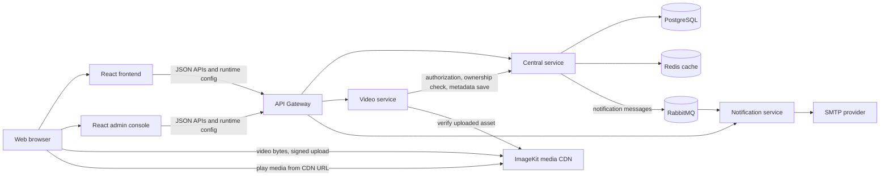

# StreamSphere system architecture

## Project at a glance

StreamSphere is a video-sharing application with React web clients and a
Java 17 / Spring Boot backend. The backend is split into services so identity
and catalog data, media upload operations, notification delivery, and browser
API routing have separate responsibilities.

The current repository contains a Gateway, Central service, Video service,
Notification service, and a Service Registry module. The Render Blueprint
deploys the first four; it does not currently provision the Service Registry.
PostgreSQL stores application records, Redis is used for Central's cache,
RabbitMQ carries asynchronous notification messages, and ImageKit stores new
video media and serves it from a CDN.

## Logical topology

## Services and responsibilities

### API Gateway

- Public backend entry point for the browser applications.
- Routes user/authentication, Central, Video, Notification, and Admin API paths
  to their respective services.
- Owns browser CORS configuration and removes the browser `Origin` header before
  forwarding requests downstream.
- Exposes `GET /api/config`, which returns the public API base URL. The clients
  load this at runtime instead of needing every API route baked into the build.
- Uses a shorter general response timeout and a longer timeout for the legacy
  multipart upload route. Current ImageKit video bytes bypass the Gateway.

### Central service

- Owns user, channel, video metadata, tags, engagement, playlists, watch
  history, reports, and in-app notification records.
- Uses PostgreSQL through Spring Data JPA; Flyway migrations define schema
  evolution.
- Issues and validates JWTs. Passwords are encoded with BCrypt.
- Provides feed, search, trending, shorts, subscription, admin, and channel
  APIs.
- Uses Redis for selected cache-aside reads, with PostgreSQL remaining the
  source of truth. Cache entries are evicted on relevant video writes.
- Publishes asynchronous email notification messages to RabbitMQ.
- Pushes in-app notifications to WebSocket topics.

### Video service

- Creates short-lived ImageKit upload authorization and accepts upload
  completion metadata.
- Checks channel ownership through an authenticated Central service call.
- Verifies ImageKit's file ID, expected folder/name, media type, size, and CDN
  host before asking Central to store the metadata.
- Does not proxy current browser-uploaded file bytes through the Video service
  or its container filesystem.
- Keeps a legacy local storage implementation for historical stream records.
  The multipart `/api/v1/video/upload` endpoint is intentionally disabled with
  HTTP 410 to prevent new uploads from silently using ephemeral local disk.

### Notification service

- Consumes notification messages from a RabbitMQ queue.
- Sends email through configured SMTP credentials.
- Uses bounded retries and a dead-letter exchange/queue to avoid infinite
  requeue loops.
- Has an in-memory, bounded duplicate-message guard. This reduces duplicate
  emails for recent redeliveries but is not a durable, cross-instance
  idempotency store.

### Other modules and infrastructure

- `service-registry` exists in the Maven reactor, but the current Render
  Blueprint uses explicit service URLs rather than deploying service discovery.
- `backend/infrastructure` contains supporting infrastructure definitions and
  examples. A folder or compose definition there does not by itself mean that
  a component is deployed or used by the application.
- The current API code and Render Blueprint use RabbitMQ, PostgreSQL, Redis,
  and ImageKit. Do not assume Kafka, MongoDB, Kubernetes, or a media worker is
  part of the deployed request path.

## Main request and data flows

### Feed and playback

1. Frontend calls `GET /api/config` and reads `apiBaseUrl`.
2. Frontend requests `GET /api/v1/central/videos?limit=...` through the Gateway.
3. Central reads the feed from PostgreSQL (or the Redis cache) and returns
   metadata such as title, channel, visibility/status, and `videoLink`.
4. Feed queries include only videos whose status is `PUBLISHED` and visibility
   is `PUBLIC`, ordered by upload time descending.
5. The browser plays the returned `videoLink`. For current uploads this is an
   HTTPS ImageKit URL, so media delivery goes directly to ImageKit's CDN, not
   through Central or the Gateway.

The metadata row and media bytes are separate resources. PostgreSQL stores the
media URL; ImageKit stores/serves the video file. A row in PostgreSQL does not
prove that the referenced file still exists.

### New video upload

1. An authenticated channel owner chooses a video in the frontend. The client
   rejects non-video MIME types and files larger than 500 MiB.
2. Frontend requests
   `POST /api/v1/video/upload/authorization` with the channel ID, file name, and
   size.
3. Video asks Central to verify that the authenticated account owns the
   channel, then returns a generated video ID, safe file name, folder, public
   key, and signed upload parameters. The ImageKit private key stays on the
   server.
4. Browser uploads the bytes directly to ImageKit using the short-lived signed
   parameters.
5. Browser sends the returned ImageKit file ID and video metadata to
   `POST /api/v1/video/upload/complete`.
6. Video checks channel ownership again, retrieves the asset details from
   ImageKit, and verifies the expected channel folder, generated name, file
   size, video MIME type, HTTPS URL, and configured ImageKit host.
7. Video asks Central to create the PostgreSQL video row using the verified
   ImageKit URL. Current completion marks this direct-upload video
   `PUBLISHED` and `PUBLIC`.
8. Home/feed can return the video because the feed query selects only
   `PUBLISHED` + `PUBLIC` records.

For a legacy record whose local media file was lost, the channel owner can
start a replacement upload from its Watch page. Video authorizes replacement
only for an existing video on the owner's channel; after verifying the new
ImageKit asset, Central updates that record's media URL without resetting its
views or descriptive metadata. The original source file must be available to
the owner; PostgreSQL cannot reconstruct missing bytes.

The ownership check happens both before upload and at completion. The second
check prevents an untrusted client from completing metadata for a channel it
does not own. An upload that reaches ImageKit but fails completion can leave an
orphaned ImageKit asset; cleanup/reconciliation is a future operational
improvement.

### Authentication and service calls

- Registration and login return a signed JWT and a role value.
- The frontend stores the token and sends it in the `Authorization` header for
  protected routes.
- Spring Security filters validate requests and populate the authentication
  principal. Central's channel upload-permission check compares that identity
  with the channel owner's email.
- Video forwards the original Authorization header when calling Central for
  permission and metadata operations.
- The Gateway forwards requests to Central/Video/Notification using configured
  service URLs. In Render these use internal service addresses.
- Admin endpoints additionally enforce the `ADMIN` role at the server; hiding
  admin UI elements is not an authorization control.

Review endpoint-level authorization before extending the API. Several
user-specific endpoints currently accept a `userId` query parameter; clients
must not be treated as trusted sources of identity merely because they send a
JWT.

Login and registration return the user ID for new sessions. Existing sessions
are upgraded on application bootstrap by calling the authenticated
`GET /api/central/user/me` endpoint, so user-specific frontend requests do not
continue to send an absent ID after a frontend deployment.

### Notifications

There are two distinct notification paths:

1. Email events are published by Central to RabbitMQ and consumed by
   Notification service.
2. In-app notifications are persisted by Central in PostgreSQL and pushed to
   `/topic/notifications/{userId}` over SockJS/STOMP WebSocket.

These paths are related to user-visible notifications but are not the same
queue or delivery guarantee. More detail is in
[Notification events](../events/notification-events.md).

## Persistence and domain model

Central's PostgreSQL schema includes these principal entities:

| Entity | Purpose |
| --- | --- |
| `AppUser` | Account, unique email, encoded password, role, profile fields |
| `Channel` | Creator-owned channel, subscriber relationship, counters, videos and playlists |
| `Video` | Metadata, ImageKit URL, status/visibility, view count, channel, tags, short-form flag |
| `Tag` | Reusable video tags |
| `VideoLike` / `Comment` | Video engagement and threaded comments |
| `UserWatchHistory` | Per-user watched-video and resume data |
| `PlayList` | Channel playlist and its videos |
| `VideoReport` | User-submitted moderation report |
| `InAppNotification` | Persisted in-app notification and read state |

Flyway SQL files live in
`backend/central/src/main/resources/db/migration`. In production, keep
`JPA_DDL_AUTO=validate` and use migrations for schema changes rather than
letting Hibernate mutate the schema.

## Caching

Central configures Redis-backed Spring caching for selected video feed,
trending, shorts, and by-ID reads, plus channel summaries. Cache TTLs differ by
data volatility. Relevant video writes evict affected video caches. Cache
errors are logged and treated as cache misses/store skips; they should not make
Redis the source of truth or prevent PostgreSQL-backed requests from working.

## Key design decisions and trade-offs

- **Direct-to-ImageKit upload:** avoids routing large files through the Gateway
  or keeping them on an ephemeral application disk; requires signed-upload
  configuration and completion verification.
- **PostgreSQL for metadata:** relational ownership and engagement data can be
  queried consistently; large media objects are kept outside the database.
- **Gateway + internal service URLs:** one browser-facing API origin and
  lower-latency private service-to-service calls; Gateway is an availability
  dependency for browser API traffic.
- **RabbitMQ for email work:** request-handling services need not perform SMTP
  delivery synchronously; delivery is asynchronous and can be retried.
- **Redis as an optional cache:** reduces repeated read load, but cache
  correctness depends on eviction/expiry and the database remains authoritative.
- **Flyway migrations:** schema changes are versioned and repeatable across
  environments.

## Production hardening opportunities

These are items to assess, not claims that they are already implemented:

- Add durable upload reconciliation/cleanup for ImageKit assets whose completion
  step failed.
- Add authorization and object-level ownership checks consistently for all
  user-specific APIs, rather than trusting a caller-supplied `userId`.
- Use durable idempotency/outbox patterns for notification publication and
  deduplication where delivery must survive restarts.
- Add explicit rate limits, quotas, malware/content checks, and upload
  lifecycle observability appropriate to the service plan.
- Configure production-grade plans, backups, retention, alerting, and incident
  response for PostgreSQL, Redis, RabbitMQ, and the web services.
- Confirm CORS, WebSocket origin rules, JWT expiry/rotation, and admin account
  provisioning against the actual production threat model.
